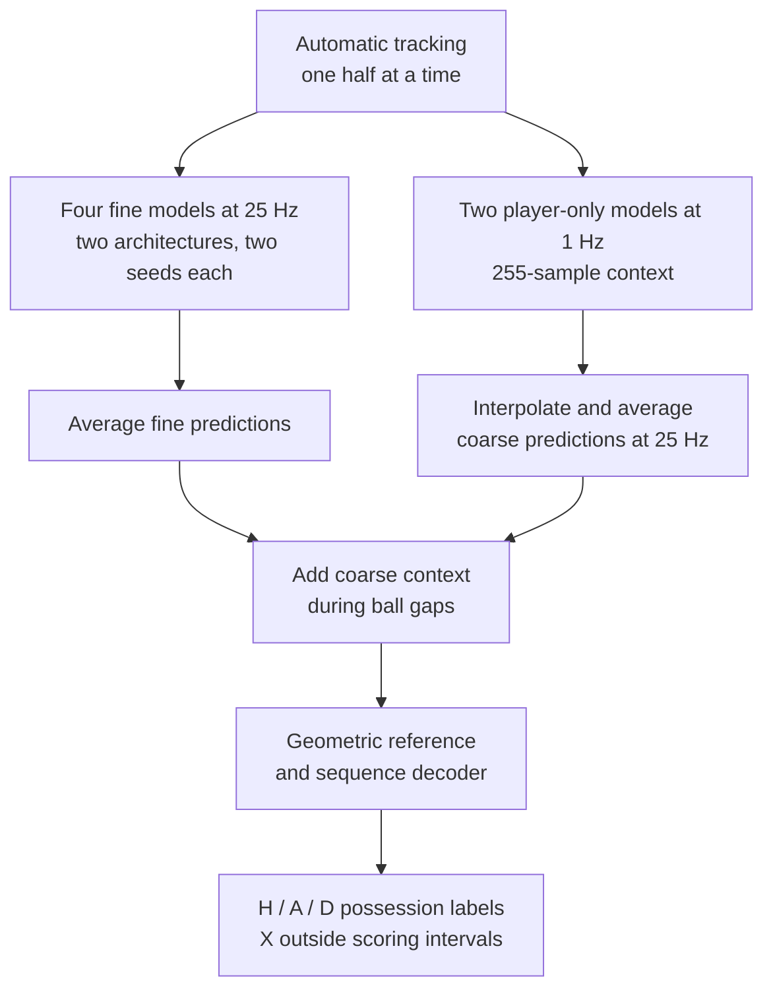

# CY-DATA-TEAM: football possession inference

An offline system for the [More Than a Hack 2027 challenge](https://github.com/metrica-sports/more-than-a-hack-2027).
It predicts home possession (`H`), away possession (`A`), dead play (`D`) or an
excluded frame (`X`) from automatic football tracking. The final v6 model uses
four temporal networks at 25 Hz and two player-only networks with roughly four
minutes of context to handle missing-ball observations.

The repository includes the trained models, pinned dependencies, a verified
submission, and a public validation reference. Participant match assets are
not included.

## Quick start

Use Python **3.12.11** and [uv](https://docs.astral.sh/uv/).

```sh
git clone https://github.com/dimitrisppt/CY-DATA-TEAM-more-than-a-hack-2027.git
cd CY-DATA-TEAM-more-than-a-hack-2027

uv sync --frozen --python 3.12.11 --extra learn --extra tune --extra dev

# Check the model bundle and pinned environment, without participant data.
uv run --no-sync python -m scripts.reproduce --verify-only

# Regenerate the challenge submission from your authorized data bundle.
uv run --no-sync python -m scripts.reproduce \
  --data-dir /path/to/participant-data \
  --output outputs/CY-DATA-TEAM.csv
```

The input directory must contain the tactical tracking pair:

- `BAR-ATH_tactical_atd.txt`
- `BAR-ATH_tactical_atd.xml`

The command accepts the standard challenge layout or finds those filenames
uniquely beneath the directory. For another layout, pass both `--raw` and
`--metadata` explicitly. It processes the files locally, verifies the model
and input hashes, validates the CSV, and checks that it matches the delivered
v6 file exactly. It sets the recorded four-thread CPU configuration itself.
See [reproduction details](docs/REPRODUCIBILITY.md) for options and recovery.

The expected CSV has **199,319 rows**, indexed from 0 to 199318. All 20,156
halftime frames are excluded, along with the published pre-match and post-match
regions. SHA256:

```text
4c22b0171509ae1f93c57b72e9394a10623e19bcc1834290c2a9ec640edfea1b
```

The ready-to-use file is [submission/CY-DATA-TEAM.csv](submission/CY-DATA-TEAM.csv).
The team technical document is [docs/CY-DATA-TEAM.md](docs/CY-DATA-TEAM.md).

## Recalculate the reported results

```sh
uv run --no-sync python -m scripts.evaluate_reference
```

This recomputes the official possession metrics from saved out-of-fold
predictions and public DFL labels in `benchmarks/v6/`. It requires no participant
assets or training run. It verifies the reference hashes and checks the scores
against the recorded experiment results. This is score reproduction from fixed
predictions, not a fresh model fit or an independent test.

## Results

These are matched development comparisons, averaged across two frozen outage
batches. Higher is better. The main objective weights clean spell F1 by 0.50,
short gaps by 0.20, long gaps by 0.15 and visibility-pattern replay by 0.15.
The missing-ball aggregate renormalizes the last three weights to sum to one.

| Metric | v4 ensemble | v5 tail EMA | v6 long context |
|---|---:|---:|---:|
| Weighted objective | 0.580751 | 0.590127 | **0.594200** |
| Missing-ball aggregate | 0.512152 | 0.525637 | **0.533782** |
| Clean spell F1 | 0.649351 | 0.654618 | 0.654618 |
| Short-gap spell F1 | 0.516673 | 0.535201 | 0.537096 |
| Long-gap spell F1 | 0.512552 | 0.516044 | 0.527686 |
| Replay spell F1 | 0.505725 | 0.522477 | 0.535459 |

Both final changes passed their fixed validation gates. Adding coarse context
improved the missing-ball aggregate on all six inner validation matches in
both batches. Its clean-scenario arrays were unchanged. Separate WMX guards
also passed.

**These are not challenge scores.** All seven public matches have been used
during development. New masks and training seeds do not make them independent
test matches. The public challenge labels were not used for training or tuning.

A subsequent [temporal calibration experiment](docs/TIME_CALIBRATION.md) compared
global shifts, transition-family shifts and a contextual boundary model with
explicit upstream training exclusions. The contextual model increased the
development objective from 0.594200 to 0.594475, below its predeclared advancement
threshold. It remains experimental and is not part of the delivered v6 model.

## How the system works



The technical report illustrates the [fine model](docs/CY-DATA-TEAM.md#fine-model-structure),
[missing-ball blend](docs/CY-DATA-TEAM.md#missing-ball-fusion), and
[validation splits](docs/CY-DATA-TEAM.md#validation-and-results). The
[reproduction guide](docs/REPRODUCIBILITY.md#choose-a-reproduction-path) shows
which inputs and commands are needed for each kind of reproduction.

1. **Mask-aware features.** Player and ball geometry, motion and missingness
   remain separate. Missing ball does not imply dead play. Each half has its
   own feature and decoding timeline.
2. **Fine temporal models.** Mean pooling and ball-conditioned attention encode
   team sets without depending on player order. Width-32 temporal convolutions
   provide a 511-frame receptive field, about 20.44 seconds. The models predict
   live/dead state, live-play ownership and typed transition boundaries.
3. **Seed ensemble and tail EMA.** Two training seeds per architecture reduce
   prediction variability. Fine weights use EMA with decay 0.99 over updates
   7,001 through 7,200, initialized at update 7,000. Raw replay parity verifies
   the original training trajectory. This is a tail average, not full-run EMA.
4. **Long context.** Two ball-free models use exact one-second player samples
   and a 255-sample receptive field. Their interpolated live/owner predictions
   contribute up to 25%, increasing with distance from a ball observation.
   Their contribution is zero when the ball is visible. Fine boundary scores
   retain native-rate timing.
5. **Sequence decoding.** A geometric reference, calibrated neural emissions
   and typed transition costs produce coherent possession spells. The decoder
   uses future context within a half. It does not bridge halftime.

The default ensemble uses six networks. Additional checkpoints inside the
model bundle authenticate training and validation provenance and are not
additional inference members. Model parameters, seeds, decoder settings and
source hashes are recorded in `models/v6/manifest.json` and its contained proofs.

## Experiments and lessons

The [experiment history](docs/EXPERIMENTS.md) records the methods, measured
outcomes and limits in detail. The main findings were:

| Experiment | Finding |
|---|---|
| Whole-match cross-validation | Keeping both halves and all windows of a match together avoids the leakage of random frame splits. Repeated use of the same matches still limits generalization claims. |
| Optuna search | Conditional grouped multivariate TPE and staged 1,200/3,600/7,200-update budgets selected complementary mean and attention models. The overnight campaign screened 36 configurations and recorded 976 decoder evaluations. |
| Spatial and temporal augmentation | More augmentation was not uniformly better. Noise and time shift had promising initial results that failed later checks. The final fine models use their specifically selected coordinate-noise and player-dropout recipes. |
| More training | Performance improved through the tested budgets. This established the best tested checkpoint, not convergence. |
| Decoder refinement | The 64-trial decoder-only candidate failed its confirmation gate. A later combined recipe with seed averaging and the frozen refined decoder passed separately. |
| Seed averaging and EMA | The validated predictor improved, but seed-dependent calibration differences remain. A better average does not mean every seed improves. |
| Player-only long context | The clearest incremental gains were on long and replayed outages. Coarse context adds capacity as well as temporal range, so their effects are not isolated. |
| Interaction pooling and visibility blending | The tested interaction models regressed. Visibility-dependent blending selected the static solution. Neither became part of v6. |

The final EMA and coarse comparisons used fixed candidates, frozen folds,
paired seeds and unchanged decoders. They were not further hyperparameter
searches. The [short-possession study](docs/SHORT_POSSESSION_REFINEMENT.md) adds
separate possession-balanced and masked-student training experiments with a
matched continuation control. They are experimental and are not part of v6.
Training was stopped after 11 of 36 planned fits. The
[partial findings](docs/PARTIAL_REFINEMENT_RESULTS.md) cover only two public
matches. Possession balancing improved their average, with more false events
and uneven match-level gains. Teacher supervision did not improve over its
matched continuation control. Their saved scores can be reproduced with
`python -m scripts.evaluate_partial_reference`, without training or T7 access.
Segment-level decoding and additional compatible labeled matches remain research
directions.

Subsequent [GPU IoU experiments](docs/GPU_IOU_EXPERIMENT.md) completed the
54-fit comparison and an 80-fit confirmation and ablation study. The
[eight-hour GPU tuning campaign](docs/GPU_TUNING.md) then completed 23 screening
recipes, 5 full-budget recipes and 540 decoder trials. Its winning pipeline
improved weighted development spellF1 from **0.604912 to 0.629368** and passed
the separate WMX guard. These scores use historically reused external matches;
they are not challenge leaderboard scores. The tuned pipeline is experimental:
the packaged model and `submission/CY-DATA-TEAM.csv` still use **v6**.

## Data and possession semantics

Supervised training uses the public **Sportec Solutions/DFL dataset** released
by Bassek et al.: seven Bundesliga matches, fourteen halves and 1,002,644 frames.
The supplied `BallStatus` and `BallPossession` fields provide targets. Inactive
play maps to `D`, known live ownership maps to `H` or `A`, and unknown supervision
is masked. Provider labels may differ from challenge conventions for loose
balls, brief challenges and restart timing. No target-match labels or manual
frame corrections are used.

Training includes synthetic ball gaps. Robustness comparisons also replay
automatically measured target visibility patterns onto public labeled matches.
The comparison labels are still from DFL. This uses the target's unlabeled
input distribution, not its possession truth.

Inference uses only the tactical automatic tracking and its metadata. Video,
broadcast tracking, Smart Tagging and homography are not v6 inputs. The earlier
SkillCorner checks were conditional home/away transfer diagnostics and did not
train v6. See [data policy](docs/DATA_POLICY.md) and
[third-party notices](THIRD_PARTY_NOTICES.md) for sources, attribution and usage
restrictions.

## Repository map

| Path | Purpose |
|---|---|
| `possession/` | Tracking parsers, features, model layers, augmentation and decoding |
| `experiments/` | Training, Optuna, whole-match evaluation and recorded experiment protocols |
| `scripts/reproduce.py` | Verified v6 inference entry point |
| `scripts/evaluate_reference.py` | Recompute development metrics from saved public predictions |
| `scripts/package_release.py` | Build a verified source/model release without participant data |
| `models/v6/` | Portable trained model bundle and provenance |
| `benchmarks/v6/` | Compact public validation reference and expected scores |
| `submission/` | Delivered CSV and its checksum manifest |
| `docs/` | Technical report, experiment history, reproduction and data policy |
| `tests/` | Parser, model, training, provenance and delivery checks |
| `configs/` | Earlier experiment configuration examples |

Generated outputs, local experiment caches and participant files are ignored
by Git. The original challenge specification, rules and scorer remain available
in [CHALLENGE.md](CHALLENGE.md), [RULES.md](RULES.md),
[SUBMISSION.md](SUBMISSION.md) and `evaluation/`.

## Development

```sh
uv run --no-sync pytest -q
uv run --no-sync ruff check scripts/reproduce.py scripts/evaluate_reference.py scripts/package_release.py
uv run --no-sync python evaluation/validate_submission.py submission/CY-DATA-TEAM.csv
uv run --no-sync python -m scripts.package_release --output dist/CY-DATA-TEAM-v6.zip
```

Full retraining and historical hyperparameter campaigns are separate from the
quick reproduction commands. They require public training data, more compute
and the experiment provenance chain. The Mac-specific `launch_*` scripts are
historical job coordinators, not the portable inference entry point.

The exact reference output was verified on macOS ARM64 CPU with the pinned
Python environment. Other hardware can change floating-point results, so the
runner checks the output hash rather than assuming cross-platform equivalence.

## License

See [LICENSE](LICENSE) for the source-code license and
[THIRD_PARTY_NOTICES.md](THIRD_PARTY_NOTICES.md) for data and software attribution.
The competition match assets have separate terms and must not be redistributed.
