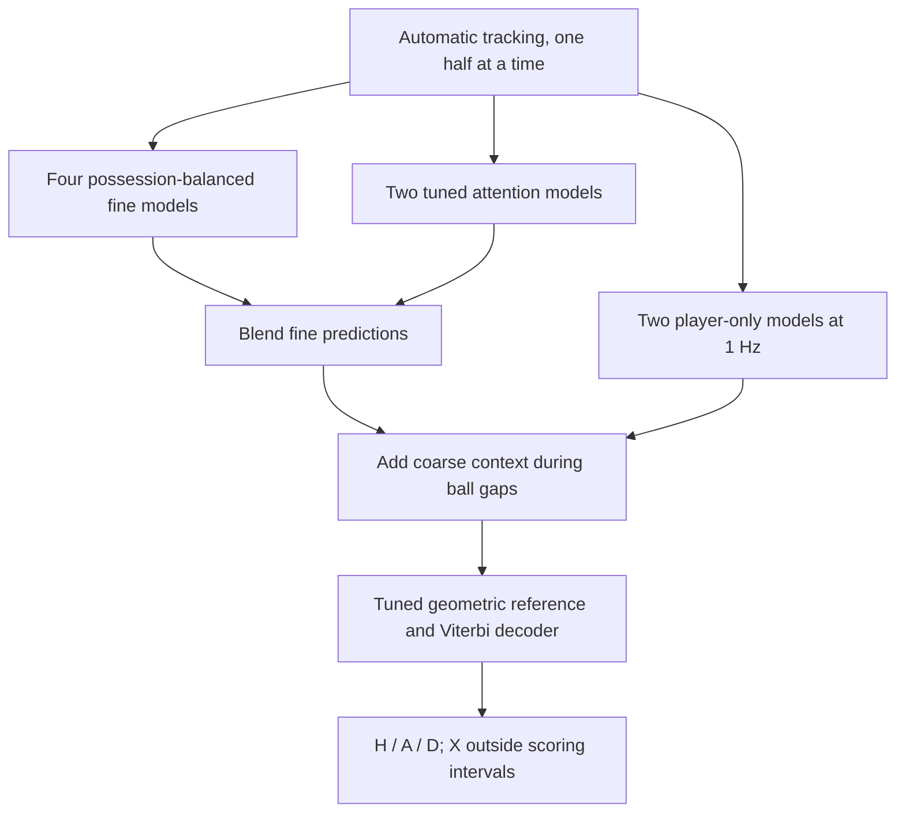

# CY-DATA-TEAM: football possession inference

An offline system for the [More Than a Hack 2027 challenge](https://github.com/metrica-sports/more-than-a-hack-2027).
It predicts home possession (`H`), away possession (`A`), dead play (`D`) or an
excluded frame (`X`) from automatic football tracking.

**The current submission is v7 and includes the confirmed GPU improvements.**
It combines possession-balanced fine models, the attention model selected by
the eight-hour tuning campaign, player-only long context, and the jointly tuned
decoder. All eight final networks are refitted on the seven public DFL matches.
Challenge possession labels are never used for training, selection or inference.

- **Submit:** [CY-DATA-TEAM.csv](submission/CY-DATA-TEAM.csv).
- **Technical document:** [PDF](submission/CY-DATA-TEAM.pdf) or [Markdown](docs/CY-DATA-TEAM.md).
- **Team:** Dimitris Papatheodoulou, Evripides Alevras, Andreas Petridis.
- **Previous submission:** [archived v6 CSV](submission/archive/v6/CY-DATA-TEAM.csv).

## Regenerate the submission

Use Python **3.12.11** and [uv](https://docs.astral.sh/uv/). Participant match
assets are restricted and must be obtained through the organizers; they are
excluded from this repository.

```sh
git clone https://github.com/dimitrisppt/CY-DATA-TEAM-more-than-a-hack-2027.git
cd CY-DATA-TEAM-more-than-a-hack-2027
uv sync --frozen --python 3.12.11 --extra learn --extra tune --extra dev

# Verify the eight models, recipe, receipts and source hashes.
uv run --no-sync python -m scripts.reproduce_v7 --verify-only

# Default device: CUDA. Use --device cpu for CPU inference.
uv run --no-sync python -m scripts.reproduce_v7 \
  --data-dir /path/to/participant-data \
  --output outputs/CY-DATA-TEAM.csv

uv run --no-sync python evaluation/validate_submission.py outputs/CY-DATA-TEAM.csv
```

The input directory must contain `BAR-ATH_tactical_atd.txt` and
`BAR-ATH_tactical_atd.xml`. The runner accepts the standard layout or finds
those filenames uniquely below the directory. Alternatively, supply both
`--raw` and `--metadata`. It verifies model and input hashes, processes halves
independently, validates the CSV, and checks its exact SHA256 against the
release manifest. Existing output files are preserved; choose a new output path
for each verification run. No experiment cache or v6 proof directory is required.

The expected output contains **199,319 rows**, frames 0–199318, with **40,462
excluded frames**, including all **20,156 halftime frames**. Its SHA256 is:

```text
d187fcf9f3840cd1391f2089dc678f07de4a7760ae09b016ce8da15c61236170
```

The release was regenerated byte-for-byte on both the Tesla T4 GPU and the
Linux CPU in the pinned environment. See [reproduction details](docs/REPRODUCIBILITY.md) and the
[release verification](submission/verification-v7.json) for the tested runtime
and regeneration checks. Hardware-dependent floating-point differences are
detected by the checksum; passing the CSV format validator does not measure
challenge accuracy. Regenerate the Barcelona-coloured PDF with
`uv run --no-project scripts/render_technical_report.py`.

## What changed in v7

| Component | Delivered v7 configuration |
|---|---|
| Original fine ensemble | Two width-32 mean models and two width-32 attention models, at 25 Hz; 7,200 parent updates plus 1,200 possession-balanced continuation updates |
| Possession balancing | Per-possession loss weight 0.25 and short-possession sampling probability 0.25; final 200-update EMA exports |
| Tuned attention addition | Two width-64, seven-block attention models; 9,600 updates, 768-frame training centers, sampling probability 0.50, raw exports |
| Fine blending | Mean architecture weight 0.619862 within the original ensemble; tuned addition weight 0.203128 |
| Long context | Two ball-free models at 1 Hz, trained for 7,200 updates; 255-second receptive field |
| Missing-ball gate | Coarse weight `0.318357 × min(d / 3.218862, 1)`, where `d` is seconds to the nearest ball observation; zero when the ball is visible |
| Decoder | Jointly tuned geometric reference, calibration, boundary scaling and typed transition costs |

The exact settings are in [configs/v7-recipe.json](configs/v7-recipe.json).
Final seeds were fixed before target inference: 20261117/20261118 for the
original fine/coarse branches and 20261119/20261120 for the new attention pair.
The original branches apply the recorded deterministic seed mapping.



Coordinates, motion and observation masks feed permutation-invariant team
encoders and dilated temporal convolutions. Missing ball does not imply dead
play. Live/dead and live-play ownership are predicted separately; typed boundary
scores help the decoder form coherent possessions. Both past and future frames
provide context, so this is an offline system. The
[technical report](docs/CY-DATA-TEAM.md) explains the design and possession rules.

## Validation evidence

The official ranking metric is **spellF1**, averaged over temporal IoUs
**0.3, 0.4, 0.5, 0.6 and 0.7**. The table below reports a development aggregate:
`0.50 × clean + 0.20 × short-gap + 0.15 × long-gap + 0.15 × replay`, with equal
whole-match weights and two fixed mask batches.

| Matched GPU-tuning assessment | Incumbent | Selected v7 recipe | Change |
|---|---:|---:|---:|
| Six-match confirmation | 0.604912 | **0.629368** | +0.024456 |
| Separate WMX guard | 0.557923 | **0.569078** | +0.011156 |
| Six-match clean-tracking spellF1 | 0.672989 | **0.688007** | +0.015017 |

The search completed 23 screening recipes, five full-budget recipes and 540
decoder trials. The frozen winner passed both confirmation gates; both candidate
seeds and all six match aggregates improved. At clean IoU 0.5, recovered short
possessions rose from 214 to 249 of 728, while spurious possessions rose from
540 to 544. Three additional candidate seeds also improved.

**These are development scores, not the challenge score of the final CSV.**
Whole-match exclusions prevent direct training leakage, but all seven matches
have historical development use. Fresh seeds and masks are robustness checks,
not independent test matches. The final all-seven model fits are separate from
these out-of-fold evaluation fits. No score has been measured on hidden
challenge labels.

Recompute the GPU table from bundled public labels and saved predictions:

```sh
uv run --no-sync python -m scripts.evaluate_v7
```

This verifies eight saved assessments and their two-batch aggregates. It needs
neither participant data nor training. Historical v4–v6 scores can still be
recomputed with `python -m scripts.evaluate_reference`; their comparison reaches
0.594200 for v6 and uses a different experiment setup. Do not treat the two
studies as one directly comparable leaderboard.

## Data and experimental lessons

Supervised training uses the **Sportec Solutions/DFL dataset** released by
Bassek et al.: seven Bundesliga matches, fourteen halves and 1,002,644 frames.
Provider `BallStatus` and `BallPossession` fields define the targets. Inactive
play maps to `D`; known live ownership maps to `H/A`; unknown supervision is
masked. No team member manually annotated the challenge match.

Challenge inference reads only the tactical automatic tracking pair. Video,
broadcast tracking, Smart Tagging and homography are not inputs. Unlabeled
challenge visibility patterns were replayed on public matches during robustness
assessment. Earlier SkillCorner diagnostics did not train or select the final
submission. See [data policy](docs/DATA_POLICY.md) and
[third-party notices](THIRD_PARTY_NOTICES.md) for attribution and restrictions.

The [experiment history](docs/EXPERIMENTS.md), [GPU IoU study](docs/GPU_IOU_EXPERIMENT.md)
and [GPU tuning record](docs/GPU_TUNING.md) retain negative results as well as
improvements. Masked-teacher training, separate sampling-only/loss-only variants,
and contextual timing correction did not pass their relevant advancement gates.
They are not part of v7. Repeated match reuse, provider label differences and
false short possessions remain important limitations.

## Repository and development

| Path | Purpose |
|---|---|
| `possession/`, `experiments/` | Parsing, features, models, training, decoding and evaluation |
| `scripts/reproduce_v7.py` | Current CSV reproduction, GPU or CPU |
| `scripts/refit_v7.py`, `scripts/export_v7.py` | Full public-data refit and portable model export |
| `models/v7/` | Eight inference models, frozen recipe and authenticated receipts |
| `benchmarks/v7/` | Public out-of-fold validation reference |
| `submission/` | Current CSV/PDF, manifests and verification; v6 archive |
| `docs/`, `tests/` | Technical report, experiment records and regression tests |

The v7 bundle is self-contained. Historical v6 inference verification remains
blocked by missing historical proof files in this checkout; its weights and
archived CSV are preserved, and v7 does not weaken or bypass that verifier.
The organizers require a **public repository URL** in addition to the CSV and
technical document. Local validation does not publish the repository or send
the submission form.

Build the verified source/model archive with
`uv run --no-sync python -m scripts.package_v7`. It writes
`dist/CY-DATA-TEAM-v7.zip`, excluding participant assets and experiment caches.

```sh
uv run --no-sync pytest -q tests/test_v7_submission.py tests/test_gpu_tuning.py \
  tests/test_campaign_submission.py tests/test_coarse_context.py
uv run --no-sync ruff check scripts/*v7*.py tests/test_v7_submission.py
```

See [LICENSE](LICENSE) for source licensing. Participant match assets have
separate terms and must not be redistributed.
