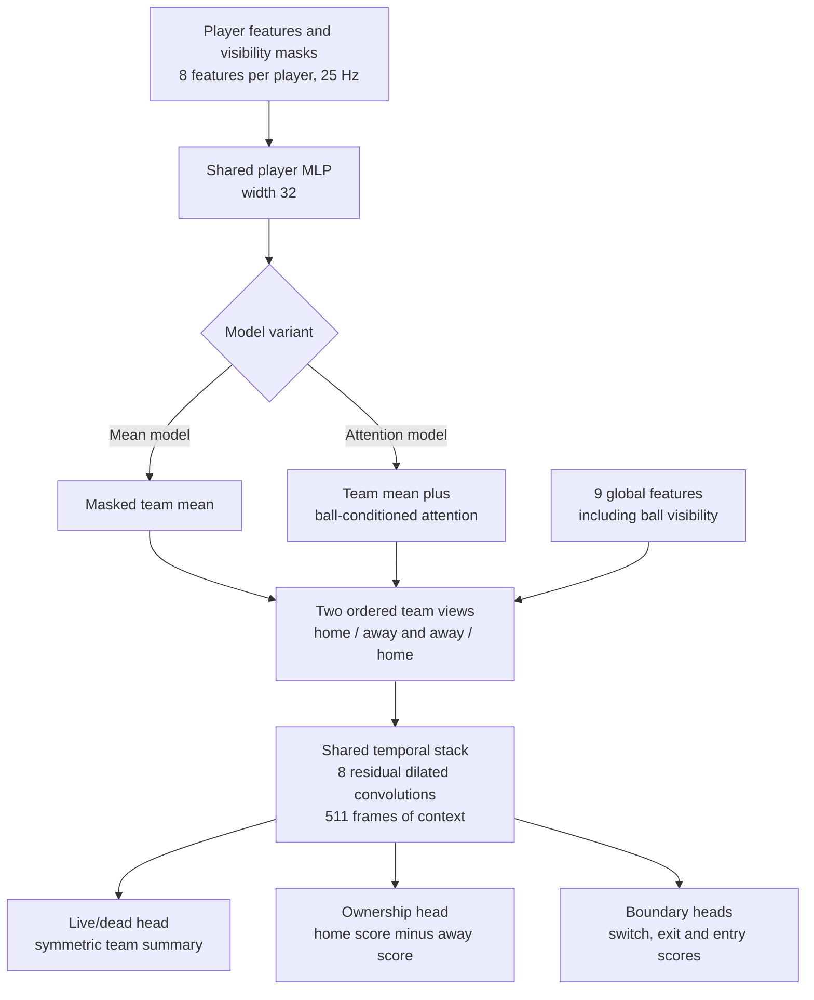
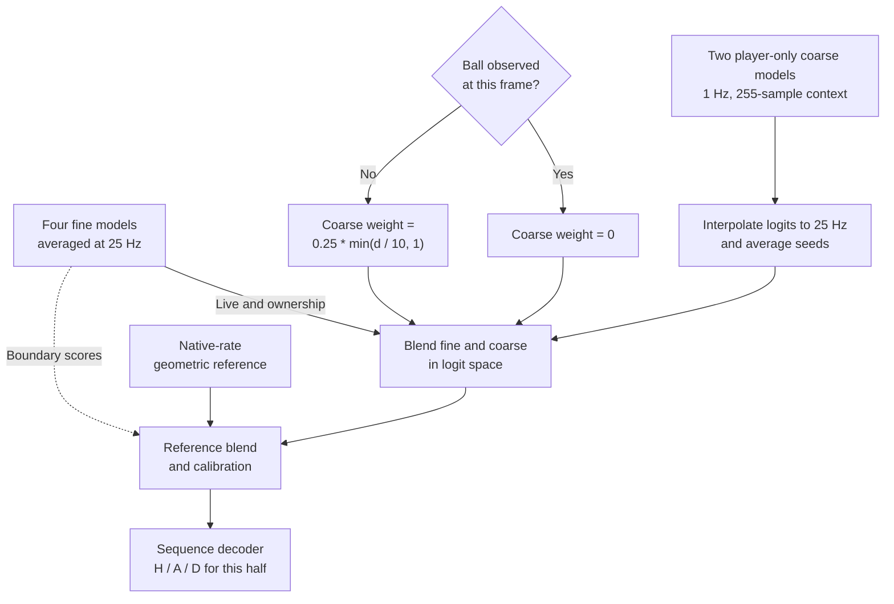
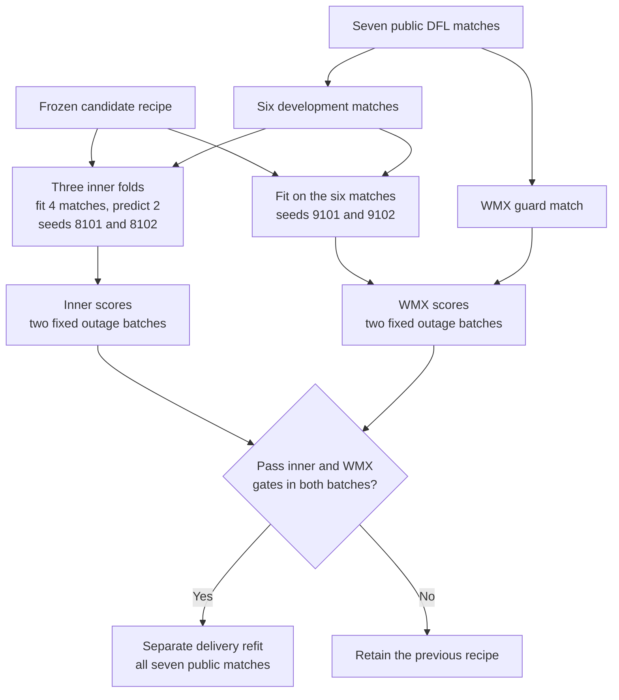

# CY-DATA-TEAM: football possession inference

## Summary

The v6 system predicts home possession (`H`), away possession (`A`), dead play
(`D`), or no answer (`X`) from player and ball tracking. It is a six-network
ensemble. Four fine models use the native 25 Hz stream. Two player-only models
add long context from a one-hertz stream when ball observations are missing.
The models and decoder are evaluated independently on each half.

The reported development objective is a weighted mean of whole-match spell F1
over clean, short-gap, long-gap, and target-visibility replay conditions. The
v6 value is 0.594200. This is not a score on the challenge match. All seven
public training matches have historical use in development.

## Data and labels

Training and model selection use the seven-match Sportec Solutions/DFL release
([dataset record](https://api.figshare.com/v2/articles/28196177)). The release
provides 1,002,644 frames across fourteen halves under CC BY 4.0. We use
automatic player and ball coordinates, visibility masks, and the supplied `BallStatus` and
`BallPossession` target fields. The team did not manually label the matches.
The release and records available to us identify the data provider and fields,
but do not establish individual annotators or a detailed annotation workflow.
We therefore make no claim about how each source label was adjudicated.

For training, inactive play maps to `D`. Active frames with known team
possession map to `H` or `A`, and frames without usable target supervision are
masked from the loss. The provider labels are a proxy for the challenge rules,
not proof that both sources use identical conventions for controlled touches,
loose balls, or restarts. The model learns from those labels and does not
explicitly enforce a last-team rule during a loose-ball phase.

An earlier diagnostic used provider-generated home/away agreement labels from
two SkillCorner proxy matches. It covered 47,121 of 118,494 frames and had no
dead-ball labels. That conditional transfer check did not train or select the
v6 model. It cannot measure three-state possession accuracy. Its full scope
and limits are described in the
[experiment history](EXPERIMENTS.md). The diagnostic implementation remains
in `experiments/skillcorner_proxy.py`.

At challenge inference, the pipeline reads the authorized tactical automatic
tracking text file and its metadata XML. It does not use either video, the
broadcast feed, Smart Tagging, homography, or target possession labels. The
provided match's first five minutes of labels were not used for training or
selection. Competition assets are excluded from the repository and
reproduction archive. During development, the tactical ball-visibility mask
was replayed on public labeled halves to measure robustness to a target-shaped
pattern of missing observations. Those scores use the public halves' labels,
not possession labels from the challenge match. Neither target predictions
nor target truth were used to select the v6 candidate.

## Model

The fine branch contains the mean-pooling `mean_007` model and
ball-attention `ball_attention_002` model, each refit at seeds 20261116 and
20261117 for 7,200 updates. Each has width 32, eight temporal blocks and a
511-frame receptive field, about 20.44 seconds at 25 Hz. The mean model uses
coordinate-noise augmentation. The attention model uses player-dropout
augmentation. Both retain team exchange and the existing ball-outage policy.

### Fine model structure

Each ensemble member has its own parameters. Within a member, both team
views share the player encoder and temporal stack. Swapping home and away
therefore swaps ownership predictions while preserving the live/dead score.



The diagram's two pooling paths are architecture alternatives. Both variants
run in the final ensemble, with two seeds each. When the ball is unobserved,
the attention summary falls back to the masked team mean. The temporal stack
uses past and future context within the same half.

### Tail weight averaging

Each fine model's final 200 updates are replayed from its authenticated
step-7,000 state. Exponential weight averaging uses decay 0.99, initialized
from the step-7,000 weights. Replay must reproduce the original raw step-7,200
model and training state before the averaged model is accepted. This is a
tail average, not an average over the whole training run.

### Player-only coarse context

The coarse branch has two width-32 mean-pooling temporal models. Their mapped
training seeds are 3400754309 and 2877491534, derived from the two final base
seeds by the recorded seed-mapping function. Each is trained for 7,200 updates
on one-hertz player-only inputs with
dilations `[1, 2, 4, 8, 16, 32, 64]`, giving a 255-sample receptive field.
The ball coordinates are zeroed and ball visibility is false at every sampled
frame. Training targets are sampled at the same exact half-local anchors.
These models cannot observe ball positions.

### Missing-ball fusion

At inference, average live and ownership probabilities in logit space within
each fine architecture. Average boundary scores linearly. Apply the frozen
architecture blend, with mean-pooling weight 0.6198620103020451.
The coarse live and ownership logits are interpolated from half-local
one-second anchors to native frame positions. Seed predictions are then
averaged in logit space. They modify only the fine live and ownership
probabilities. Their maximum blend
weight is 0.25, scaled by `clip(nearest_ball_seconds / 10, 0, 1)` and set to
zero when the ball is visible. Then combine with the geometric reference and
apply the three-state sequence decoder. Fine boundary probabilities, reference
features, and decoder settings remain fixed. The complete timeline remains at
25 Hz. Halftime and other frames outside the published scoring spans are `X`.



Here `d` is the distance in seconds to the nearest observed ball in the same
half, including a future observation. A ten-second distance reaches the
maximum coarse weight of 0.25. The coarse branch preserves fine boundary
scores and the geometric reference. Those signals still undergo the frozen
downstream blending and calibration. Missing ball is an input condition,
not a dead-play label.

## Validation and results

Selection and comparison use whole-match folds. The inner design has three
folds, each with four training matches and two validation matches. Separate
WMX evaluations use seeds 9101 and 9102. Confirmation uses seeds 8101 and
8102. The same source matches and related masks have appeared in earlier
experiments, so these are development comparisons rather than independent
match tests.

The final candidate comparisons follow this flow. Both halves and all
windows from a match stay together in every split. The earlier search and
selection stages are described in [the experiment history](EXPERIMENTS.md).



Each batch evaluates clean, short-gap, long-gap and visibility-replay
conditions. Inner scores and WMX scores remain separate. The all-seven
delivery fits produce the submission models and do not supply the validation
table. WMX was excluded from these guard fits, but has prior development use.
It is not an untouched test match.

| Candidate | Weighted development objective | Missing-ball aggregate |
|---|---:|---:|
| v4 four-network seed ensemble | 0.580751 | 0.512152 |
| v5 tail-EMA fine ensemble | 0.590127 | 0.525637 |
| v6 fine ensemble plus coarse context | 0.594200 | 0.533782 |

The v4-to-v5 and v5-to-v6 rows are matched comparisons on the frozen outage
batches for those phases. Both changes passed their declared per-batch gates.
The v6 coarse addition preserved clean prediction arrays exactly in its
comparison. The two mask batches reuse the same matches and model seeds. Their
results do not establish performance on unseen matches or the challenge
match. No challenge accuracy claim is made.

The challenge defines `H` and `A` as a team in possession while the ball is
live, and `D` as dead play. The model uses tracking and learned provider labels
to estimate these states. It does not inspect video or apply hand-written
frame corrections. Loose-ball control, brief touches, and restart boundaries
remain difficult cases. The four-minute coarse receptive field cannot recover
high-frequency motion removed by one-hertz sampling, and its gate cannot
replace ball evidence when the ball is visible. More independent labeled
matches are needed to estimate transfer reliably. See the official
[challenge definition](../CHALLENGE.md), [submission requirements](../SUBMISSION.md),
and [rules](../RULES.md).

## Reproduction

With the authorized participant input bundle, the published source, the v6
model files, and the pinned Python 3.12.11 environment:

```sh
uv sync --frozen --python 3.12.11 --extra learn --extra tune --extra dev
uv run --no-sync python -m scripts.reproduce \
  --data-dir /path/to/participant-data \
  --output outputs/CY-DATA-TEAM.csv
```

The default model directory is `models/v6`. The runner verifies model and
input manifests, checks the required 199,319-row CSV format, and confirms the
output hash against the delivered v6 file. Do not add participant assets to
the public repository. The reproducible archive contains source, models,
proof records, and public-data prediction caches, but not participant
tracking or video.

The saved validation table can be recalculated with
`uv run --no-sync python -m scripts.evaluate_reference`. See
[reproduction details](REPRODUCIBILITY.md) for environment checks, input
layouts, archive creation and the distinction between scoring and retraining.
