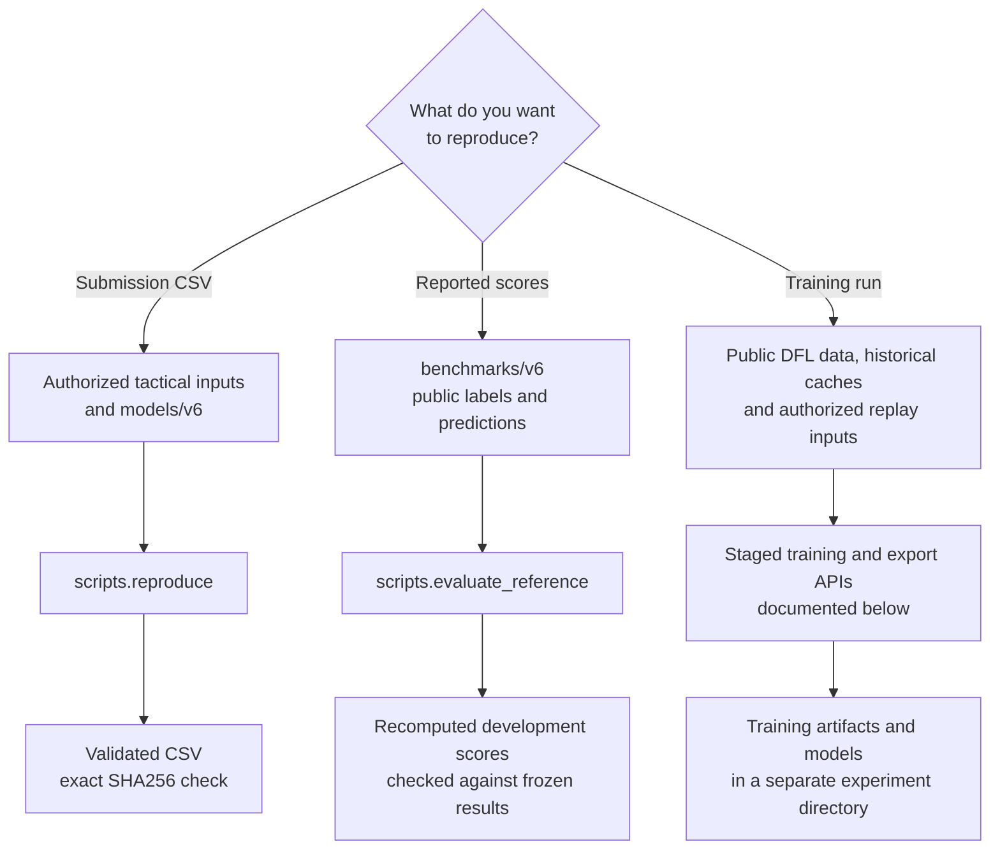

# Reproducing v6

There are three different operations: regenerating the delivered CSV,
recalculating development scores from saved predictions, and fitting models
again. The first two are supported by compact, verified release artifacts.
Retraining requires the public source data and a longer experiment workflow.

## Choose a reproduction path



The score path reads saved predictions and performs no model fitting.
The submission path runs the saved networks on participant inputs. The
training path needs additional artifacts and is not a single-command
workflow from the compact release.

## Environment

Run commands from the repository root. Use Python 3.12.11 and `uv`:

```sh
uv sync --frozen --python 3.12.11 --extra learn --extra tune --extra dev
```

The model manifest records this environment:

| Component | Version |
|---|---|
| Python | 3.12.11 |
| PyTorch | 2.14.1 |
| NumPy | 2.5.4 |
| pandas | 3.1.0 |
| Optuna | 5.0.0 |
| scikit-learn | 1.9.1 |
| Numba | 0.68.0 |

The runner sets four compute threads and one PyTorch interop thread before
inference. The reference was produced on macOS ARM64 CPU. A different platform
may produce different floating-point decisions. The hash check detects that
difference. Python or package version changes deliberately fail verification.
Use the locked environment instead of editing the manifest to suppress checks.

## Verify the model without participant data

```sh
uv run --no-sync python -m scripts.reproduce --verify-only
```

This authenticates the portable model files, proof records, pinned source
files and runtime. It does not read participant inputs or run inference.
Keep `models/v6/` and the pinned runtime source intact. Additional wrapper
scripts and documentation do not change the measured predictor.

## Regenerate the submission

Obtain the participant inputs through the organizers and keep them outside
version control. The reproduction runner accepts the standard directory or
finds these filenames uniquely below the supplied directory:

```text
BAR-ATH_tactical_atd.txt
BAR-ATH_tactical_atd.xml
```

```sh
uv run --no-sync python -m scripts.reproduce \
  --data-dir /path/to/participant-data \
  --output outputs/CY-DATA-TEAM.csv
```

For explicit paths:

```sh
uv run --no-sync python -m scripts.reproduce \
  --raw /path/to/BAR-ATH_tactical_atd.txt \
  --metadata /path/to/BAR-ATH_tactical_atd.xml \
  --output outputs/CY-DATA-TEAM.csv
```

Both explicit inputs are required together. An unfamiliar directory layout
is normalized by copying just this pair into an ignored, hash-keyed directory
under `artifacts/reproduce-input-v1/`. The existing standard manifested layout
can be read directly. No extra challenge assets are needed.

Success means the official CSV validator passed and the output SHA256 is:

```text
4c22b0171509ae1f93c57b72e9394a10623e19bcc1834290c2a9ec640edfea1b
```

The output has 199,319 rows, frames 0 through 199318, and 40,462 excluded
frames. This includes all 20,156 halftime frames. The runner writes an adjacent
`.manifest.json` file with the inference provenance. Both halves are processed
independently. There is no temporal context or decoding across halftime.

Repeated requests with the same verified output and sidecar can reuse them.
A differing request or incomplete output pair is rejected. Choose a new
output filename after a failed run, or inspect and remove only its incomplete
generated output and sidecar. Input or model hash failures should be resolved
by restoring the correct files. Do not change hashes to make a mismatch pass.

## Recalculate the validation table

```sh
uv run --no-sync python -m scripts.evaluate_reference
```

The reference contains public DFL labels and decoded out-of-fold predictions
for v4, v5 and v6. It covers two frozen batches, seven matches, four scenarios
and two halves. The six inner matches and the separate WMX guard remain
separate in the reported scores. The README table averages the two inner
batch results with equal match weights.

The evaluator verifies the archive and per-array hashes, joins halves with
an excluded separator, and runs the original challenge scorer. It checks the
recomputed scores against the frozen study records. No model training,
participant inputs or target possession labels are required. The fixed-label
reference makes scoring quick without rerunning the networks or decoder.

The objective is `0.50 * clean + 0.20 * short + 0.15 * long + 0.15 * replay`.
The missing-ball aggregate uses the last three terms divided by 0.50.
New outage batches reuse the same source matches. These are development
comparisons, not an independent held-out estimate or a challenge score.

## Recalculate the stopped refinement comparison

```sh
uv run --no-sync python -m scripts.evaluate_partial_reference
```

This verifies and scores the committed
[partial reference](../benchmarks/partial-refinement-v1/manifest.json), including
both fine-seed comparison groups and the short-possession counts. It requires
no T7 storage, tracking inputs, models or training. The two-seed and one-seed
comparisons stay separate. These results cover two historically reused public
DFL matches and one of three planned assessment folds, after 11 of 36 fits.
Training remains stopped. See the
[findings and limitations](PARTIAL_REFINEMENT_RESULTS.md).

## Build a release archive

```sh
uv run --no-sync python -m scripts.package_release \
  --output dist/CY-DATA-TEAM-current.zip
```

The builder verifies the delivered CSV, source pins, models and public
reference before creating the archive. Every included file has a SHA256 in
`package-manifest.json`. ZIP entry order and timestamps are fixed. Building
again from unchanged files produces the same archive and reuses it. The
builder refuses to replace an existing archive whose contents differ.

The previously verified `dist/CY-DATA-TEAM-v6.zip` remains frozen. The current
checkout adds experimental timing-calibration code and its public comparison
reference, so package it under a different filename. Its delivered model and
submission are still v6. The optional timing reference is scored and verified
before inclusion. See [the timing experiment](TIME_CALIBRATION.md) for its
validation protocol and limitations.

The package includes the source, license notices, documentation, trained
models, public validation reference and delivered CSV. It excludes private
data, experiment caches, environments and generated local outputs. Extract
it into a new directory, install the locked environment, and use the same
reproduction commands there.

## Retraining and historical searches

The public training data can be restored and prepared from a clean checkout:

```sh
uv run --no-sync python -m experiments.fetch_dfl --all
uv run --no-sync possession prepare \
  --raw-dir data/external/dfl \
  --output data/processed/dfl
```

Downloads and prepared arrays remain under ignored `data/`. The source is the
public DFL release linked in [third-party notices](../THIRD_PARTY_NOTICES.md).
This is distinct from the restricted participant match.

The experiment code retains the following stages:

| Stage | Entry point | Required inputs |
|---|---|---|
| Initial and nested selection | `experiments.tune`, `experiments.select` | Prepared public matches and whole-match fold definitions |
| Overnight search | `experiments.overnight_tuning` | Prepared DFL, baseline recipe, authorized target inputs for visibility replay, output directory and study database |
| Raw final fine fits | `experiments.campaign_refit` | Frozen campaign records, prepared public matches, final seed and fresh output directory |
| EMA validation | `experiments.ema_stability.run_ema_stability` | Campaign, polish and bagging records, cached predictions, update-7,000 training states and replay inputs |
| Final fine EMA export | `experiments.ema_submission.export_ema_bundle` | EMA study, both raw final bundles and prepared public data |
| Coarse validation | `experiments.coarse_stability.run_coarse_stability` | Frozen campaign and candidate records, EMA cache, public and authorized replay inputs |
| Final coarse fit and export | `experiments.coarse_submission.export_coarse_bundle` | Accepted coarse study, final EMA bundle and derived one-hertz public cache |

For example, a new overnight search has this command shape:

```sh
uv run --no-sync python -m experiments.overnight_tuning \
  --data-dir data/processed/dfl \
  --target-dir /path/to/manifested-participant-inputs \
  --baseline configs/focused-baseline.json \
  --output-dir artifacts/new-overnight-study \
  --database artifacts/new-overnight-study/study.db \
  --hours 12 --per-family 12 --decoder-trials 12 32 64
```

This starts a new search. It does not promise the exact historical trial
sequence or scores. The EMA and coarse export entry points above are Python
APIs. Their module CLIs perform inference. The old `scripts/launch_*` wrappers
encode the original Mac and storage layout and are retained as historical
job coordinators.

**Full exact retraining is not a single-command clean-checkout workflow.**
It requires the archived study records, prediction caches and training states
in addition to public data and authorized replay inputs. The compact release
includes the inference weights and their proofs, not every intermediate
training cache. The original local records are retained outside the public
repository. To extend the system, use a fresh experiment directory and report
new results separately from the frozen v6 reference.

## Development checks

```sh
uv run --no-sync pytest -q
uv run --no-sync ruff check scripts/reproduce.py scripts/evaluate_reference.py scripts/package_release.py
uv run --no-sync python evaluation/validate_submission.py submission/CY-DATA-TEAM.csv
```

The tests cover data parsing, augmentation, temporal models, match-disjoint
validation, checkpoint resume, artifact integrity and submission contracts.
They use fixtures and do not require participant data. Exact delivery parity
also requires running the inference command with the authorized input pair.
