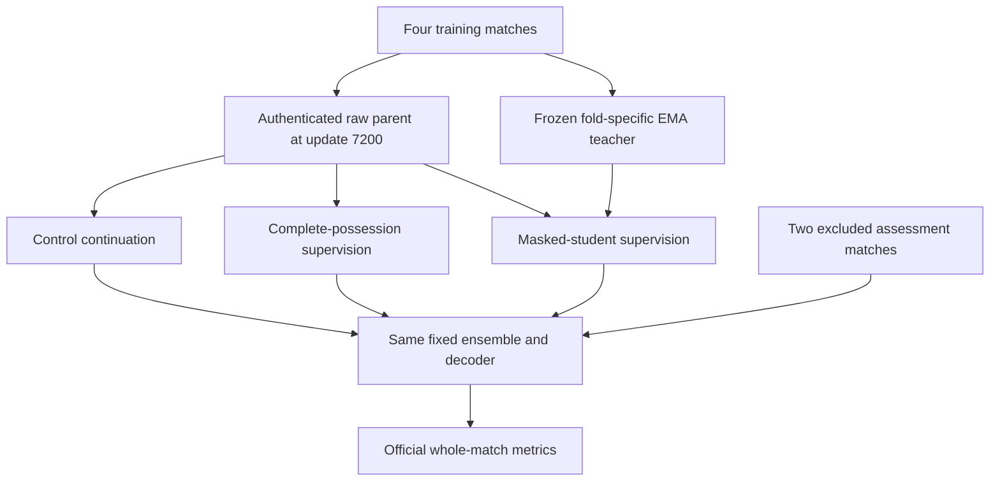

# Short-possession refinement

The delivered model remains v6. This study tests whether event-balanced
supervision or an unmasked teacher can improve the evidence available to its
frozen decoder. It includes a matched extra-training control so that a change
cannot receive credit merely for running more optimizer updates.

## Why this experiment

An audit of six inner public matches, using batch 1 without additional ball
corruption, found 2,550 true possessions and 1,959 predicted possessions.
At temporal IoU 0.5, 1,042 true possessions were missed and 451 predictions
were spurious. Possessions shorter than two seconds contributed 540 misses.

Of 315 short possessions with no same-team decoded overlap, 217 also had no
correct framewise argmax state in either the raw neural or final blended
emissions. Among these 315 events, only 18 exact ground-truth interval insertions
improved the emission score but lost after the sequence terms were included.
All 18 incurred boundary penalties.

Removing boundary scores recovered more short events, increasing matches from
188 to 235, but increased spurious possessions from 451 to 891. The pooled
IoU 0.5 spell F1 fell from 0.66888 to 0.63126. Removing switch costs provided
little recovery. These diagnostic ablations do not support broadly weakening
the decoder.

All 540 missed short possessions had a visible ball in these clean caches.
This particular error is not explained by missing ball observations alone.
Framewise argmax coverage and exact ground-truth insertions are diagnostics,
not oracle performance estimates or prediction methods.

Reproduce the audit with:

```bash
.venv/bin/python -m experiments.spell_evidence_audit \
  --manifest /Volumes/T7/Data/more-than-a-hack-2027/artifacts/timing-calibration-v1/cache/manifest.json \
  --output outputs/improvement-opportunities/predecoder-audit.json
```

The detailed audit is saved in
`outputs/improvement-opportunities/predecoder-audit.json` and its accompanying
Markdown note.

## Three matched variants

| Variant | Training change |
|---|---|
| `control` | Continue the original supervised objective and sampling policy. |
| `spell_balanced` | Add complete short-possession sampling and an auxiliary loss averaged equally across complete possessions. |
| `masked_teacher` | Add detached, confidence-gated teacher supervision on newly hidden ball frames. |

Each variant starts from the same authenticated raw checkpoint and optimizer
state at update 7,200. Each receives 1,200 extra updates. The constant learning
rate is 0.2 times the original recipe's base learning rate. An EMA is initialized
at update 8,200 and averages the following 200 updates with decay 0.99. Both
fine architectures and both existing training seeds are retained. There are
36 continuation fits: three variants, three folds, two seeds and two fine
architectures.

The architectures, base frame and typed-boundary losses, outage policy,
spatial augmentation, inference windows, ensemble weights, coarse predictions,
reference blend, temperatures and decoder all remain fixed for the comparison.
The existing correlated-outage search is not repeated in this study.

### Complete-possession supervision

The original sampler already chooses a transition-centered window half the
time. The new sampler first chooses, with probability 0.25, a complete H or A
possession shorter than 50 native frames. It samples a window containing the
whole event and both neighboring frames. Otherwise it uses the original
sampler. If no eligible short event fits, it falls back to that sampler.

A possession is eligible only when its two boundaries are observed. Unknown
labels, invalid time, missing frame IDs, half edges and clipped window edges
censor events. Stoppages are not auxiliary possession events.

For each complete possession in the supervised center, live and conditional
owner BCE are averaged over the event's frames. The event losses are then
averaged equally and added to the original objective with weight 0.25. A long
event therefore cannot dominate this auxiliary loss through its frame count.
Long events clipped by the center retain their original frame supervision.
This loss is a surrogate and is not the official one-to-one spell matching
metric.

### Teacher supervision for missing balls

The teacher is the existing fold-specific EMA model, trained on exactly the
same four training matches as the student. It is frozen in evaluation mode.
Its view uses the same player transformations, time mapping and team ordering
as the student's view, with no additional ball hiding. Student sampling,
augmentation draws and masks are identical to the control.

Teacher supervision applies only where the ball was visible to the teacher
and deliberately hidden from the student. It also requires valid training
labels, teacher confidence of at least 0.8 and agreement with the relevant
gold label. Owner supervision additionally requires known live play and a
confident live teacher. Naturally missing ball frames do not contribute to
this auxiliary loss.

The auxiliary objective is Bernoulli KL from teacher to student for the live
and owner heads, with temperature 2 and the usual temperature-squared scaling.
Its weight is 0.25. Boundary logits are not distilled. Teacher gradients are
disabled, and no teacher or labels are needed at inference.



## Validation and interpretation

Both halves, every window and every corruption scenario of a match belong to
the same fold. Parent checkpoints, teachers and the frozen coarse models all
exclude the assessment pair. Their actual saved ancestry is checked, including
the raw parents of EMA teachers. Model and input hashes bind the predictions
to their declared fit and exact corruption masks.

All variants finish their fixed training schedules before comparative scores
are calculated. There is no validation-driven early stopping, decoder retuning
or candidate hyperparameter search. The separate WMX guard is excluded from
this initial screen.

The objective is the equal-match average of 0.50 clean, 0.20 short-gap,
0.15 long-gap and 0.15 replay spell F1. Two fixed mask batches are averaged
within each match. Seeds and masks are not counted as independent matches.
The report also includes duration-binned recall, missed and spurious
possessions, frame macro F1 and transition F1.

A training technique warrants further confirmation only if it beats both
v6 and the continuation control by more than 0.002 in the objective, improves
at least four of six matches, improves the missing-ball aggregate and both
mask batches, and loses no more than 0.01 in any scenario. Passing this screen
does not automatically replace the delivered model or submission. A separate
guard and further confirmation are still needed.

All seven public matches have been used during earlier development. Direct
training exclusions do not remove historical model-selection bias. These
results are development comparisons, not challenge scores or estimates from
an untouched test set. Challenge possession labels are never read or used.

## Running and reproducing

The study uses the already verified public DFL prepared data, fold checkpoints
and cached public outage inputs on T7. It does not read participant tracking,
video or tagging files. The existing replay scenario carries previously
measured unlabeled visibility patterns into public data.

Authenticate the dependencies and freeze the protocol without training:

```bash
.venv/bin/python -m experiments.possession_refinement --plan-only
```

Run the fixed study, with an eight-hour wall-clock cap:

```bash
caffeinate -i .venv/bin/python -u -m experiments.possession_refinement --hours 8
```

Use `--artifacts-root` and `--output-dir` to override storage locations.
The default output is
`/Volumes/T7/Data/more-than-a-hack-2027/artifacts/possession-refinement-v1`.
`status.json` records the current stage. Each 200-update chunk is saved with
optimizer state, generators, sampling transcript, counters and partial EMA.
Rerunning the same command resumes verified work. The persistent wall-clock
deadline includes downtime and cannot silently reset on resume.

After completion, the output contains:

| Artifact | Contents |
|---|---|
| `protocol.json` | Frozen folds, settings, source hashes and parent ancestry. |
| `fits/` | Resumable state, EMA checkpoints and training progress. |
| `predictions.json` | Exact fitted model and cached input identities. |
| `reference/` | Compact public truth and decoded labels for every variant. |
| `result.json` | Official scores, duration diagnostics and confirmation gates. |

Recompute the comparison using only the saved label reference and repository
software, without models or tracking data:

```bash
.venv/bin/python -m experiments.possession_refinement \
  --score-reference /path/to/possession-refinement-v1/reference
```

The reference manifest and label file are hash-verified before scoring. Existing
artifacts are reused only when their configuration and content agree. The v6
release, source pins and submission CSV are not modified by this runner.

Generate a readable comparison, with an independent label-only reproduction
check:

```bash
.venv/bin/python -m scripts.report_possession_refinement \
  --study-dir /path/to/possession-refinement-v1
```

Adding `--wait` observes an already running study and writes
`outputs/possession-refinement/comparison.md` when it finishes. It does not
restart stopped jobs or change their budgets.

## Current state

The implementation and public-data preflight are complete. Training was stopped
at the user's request after 11 of 36 fits completed. The partial next fit and
completed fits retain their saved checkpoints. The report watcher was also
stopped.

A subsequent descriptive analysis of saved predictions covers only WOH and
WOY. With both fine-model seeds, possession balancing scores 0.618443 versus
0.612521 for v6 and 0.611245 for extra training alone. Short-possession recall
rises from 29.8% to 34.9%, while spurious predictions rise from 141 to 171.
The gain is uneven across the two matches. With the common completed fine-model
seed, the teacher scores 0.594668 versus 0.594806 for its matched control,
providing no incremental benefit at these settings.

These are partial development results, not a completed cross-validation or
challenge score. V6 remains the delivered model. Recompute both partial comparisons from the
committed public labels, without training or T7 storage:

```sh
uv run --no-sync python -m scripts.evaluate_partial_reference
```

See the [published partial findings](PARTIAL_REFINEMENT_RESULTS.md) and
[portable reference](../benchmarks/partial-refinement-v1/manifest.json).
