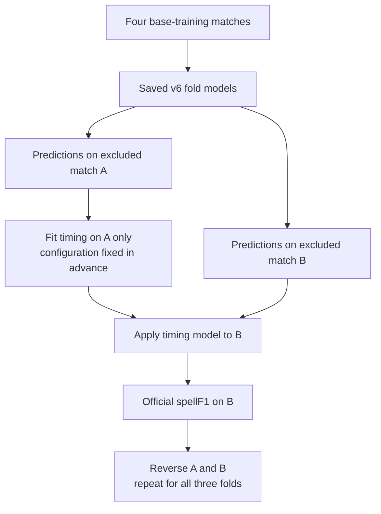

# Temporal calibration experiment

The implemented contextual calibrator produced a small development improvement,
from **0.594200 to 0.594475** on the weighted spellF1 objective. The gain did not
pass the improvement gate fixed before assessment, so v6 remains the delivered
model. Fixed global and transition-family offsets reduced the average score.

The completed comparison uses six disjoint base/calibration/assessment splits
and a separate historically reused guard. The larger nested study is implemented
and prepared, but has not been trained or evaluated. Its estimated additional
base-model training cost is about 9.5 hours on the development Mac, before
inference and calibration.

## Results

All values use the official scorer, with equal match weights and equal weights
for two existing outage batches. The objective is
`0.50 * clean + 0.20 * short + 0.15 * long + 0.15 * replay`.
The missing-ball aggregate renormalizes the last three weights to one.

| Method | Weighted spellF1 | Change from v6 | Missing-ball aggregate |
|---|---:|---:|---:|
| Unchanged v6 | 0.594200 | 0 | 0.533782 |
| Fitted global offset | 0.593477 | -0.000723 | 0.533242 |
| Fitted transition-family offsets | 0.592860 | -0.001340 | 0.532628 |
| Contextual timing model | 0.594475 | +0.000275 | 0.533882 |

| Condition | Unchanged v6 | Contextual model | Change |
|---|---:|---:|---:|
| Clean | 0.654618 | 0.655068 | +0.000449 |
| Short gaps | 0.537096 | 0.537086 | -0.000010 |
| Long gaps | 0.527686 | 0.527933 | +0.000247 |
| Replayed gaps | 0.535459 | 0.535559 | +0.000099 |

Four of the six match objectives improved, one worsened and one was unchanged.
The largest improvement was +0.001106 and the largest loss was -0.000307.
A descriptive match-bootstrap interval for the mean change is approximately
[-0.000078, +0.000686]. This includes zero. Shared upstream fits and historical
reuse mean that it is not an independent-test confidence guarantee.

On the separate WMX guard, fitting timing on all six development matches changed
the objective from 0.532438 to 0.532896. Its missing-ball aggregate changed from
0.471692 to 0.471668. This small mixed result is reported separately and was not
used to retune the configuration. WMX has been used during earlier development.

The predeclared advancement gate required an objective gain above 0.002, an
improvement on at least four of six matches, a better missing-ball aggregate,
performance above both simpler offsets, no scenario loss above 0.01 and no guard
objective loss above 0.01. The contextual model passed every condition except
the minimum objective gain. The expensive nested training stage was therefore
not launched, and no new submission replaced v6.

## Completed validation protocol

Each existing base-model fold trained on four matches and excluded two. For
each excluded pair, timing is fitted on one match and assessed on the other.
The roles are then reversed. Neither excluded match appears in that base fit.
This yields six assessment matches while avoiding indirect training leakage
through another fold's base models.



The timing model learns from one calibration match in each of these splits.
This is a smaller training set than the proposed nested four-match design.
It is a valid assessment of this training procedure, not a substitute for
measuring the larger calibration procedure.

For the guard experiment, timing is fitted on the six public out-of-fold
prediction sets. Every upstream fit excludes WMX and its own prediction match.
Assessment uses the separate base models trained on all six matches. No
assessment labels choose timing weights, offsets, scaling or hyperparameters.

All seven matches previously influenced architecture or configuration selection.
Excluding current fit ancestry does not erase that history. These remain
development comparisons, not challenge scores or new independent test results.
The challenge match's human labels were not accessed for this experiment.

## Model and boundary decoding

`possession/timing.py` implements a small shared linear candidate scorer with
regularized effects for restarts, stoppages and team switches. For each existing
boundary it predicts a categorical distribution over corrections from -25 to
+25 frames. Positive values move the transition later.

Features include relative state evidence on each side, signed typed-boundary
scores, local slopes and entropy, ball visibility and observation distance,
fine/coarse disagreement, and adjacent segment lengths. Home/away exchange uses
the same relative features and shared family effects. Match IDs are used for
weighting and validation only, never as predictive features.

The offset head uses weighted categorical likelihood with L2 regularization.
A separate logistic head estimates whether the proposed boundary has an
unambiguous same-type counterpart within the search radius. Its output mixes
the learned offset distribution with a point mass at zero correction.
Scaling is fitted on calibration-training examples only. Matches receive equal
total weight, with the specified scenario weighting and no extra weight for
duplicated outage batches.

Ground-truth association preserves ordering and exact transition type.
Competing or crossing matches are marked ambiguous and excluded from offset
supervision. They remain in complete-sequence assessment. Reliability predicts
matchability under this association rule, not a guarantee of improved spellF1.

Dynamic programming jointly selects strictly ordered integer boundaries within
each valid run. It retains the original state order, number of segments, frame
grid and X mask. Every segment remains at least one frame long. There is no
movement across halftime or excluded intervals. Identity is always a feasible
choice, and deterministic ties prefer less movement.

The fixed configuration uses radius 25, shared L2 0.05, family L2 0.20, prior
strength 0.05 and movement penalty 0.05. Extra frame-evidence weight is zero in
this experiment. The optimizer allows 200 iterations. All offset and reliability
fits converged. No Optuna search was run on the assessment matches.

Across both batches and all four scenarios, the contextual model moved 778 of
18,535 assessed boundary instances and changed 2,093 frame labels. The largest
correction was 23 frames. These counts include repeated conditions on the same
source matches. They are not counts of independent possessions.

The design adapts relative boundary distributions from
[TriDet](https://arxiv.org/abs/2303.07347) and the separation of state and boundary
evidence from [ASRF](https://arxiv.org/abs/2007.06866). Their action-localization
results do not establish football possession performance.

## Provenance and correctness checks

`experiments/timing_cache.py` verifies saved fit and model hashes, raw training
ancestors, prediction hashes, input hashes and pinned base source files. All
112 reconstructed v6 outputs and public truth arrays must exactly match the
existing frozen reference before they can enter the timing study.

`experiments/timing_validation.py` recursively checks declared training and
selection ancestry. Assessment matches and each prediction's own match are
forbidden in every fitted ancestor. Missing provenance, an incomplete component
inventory, unknown identities, inconsistent array hashes or split mismatches
cause rejection. Historical configuration selection is recorded explicitly,
without exempting direct training leakage.

Protocols are frozen before assessment. Their publication uses an advisory
lock and atomic replacement, which supports the T7 filesystem. Completed study
reuse verifies model and prediction artifacts. The corrected study protocol is:

```text
9eb80877c8ff83e001fb43ca732ff91aef69c00a21dea675bc04f340d9b75e50
```

An initial integration run incorrectly clipped signed boundary scores into the
probability range. That run is retained as superseded and is excluded from the
tables above. A regression test now verifies that distinct negative boundary
peaks remain distinguishable. The corrected model format is version 2 and
rejects the earlier format. Configuration defaults did not change for the rerun.

Other tests cover indirect ancestry leaks, match/scenario grouping, exact
identity behavior, negative and positive correction signs, colliding boundaries,
short segments, missing evidence, half and X boundaries, team symmetry,
serialization, fixed-shift optimality and reference tampering.

## Reproduce the comparison

The compact public-only reference contains labels and audit metadata. It can
recompute the reported scores without participant assets or model training:

```sh
uv run --no-sync python -m scripts.evaluate_timing_reference
```

Refitting the calibrators requires the authenticated rich public prediction
caches from the earlier v6 experiments. With those historical artifacts present:

```sh
uv run --no-sync python -m scripts.export_timing_cache \
  --artifacts-root /path/to/historical-artifacts \
  --output-dir /path/to/timing-cache

uv run --no-sync python -m experiments.timing_study \
  --cache-dir /path/to/timing-cache \
  --output-dir /path/to/new-timing-study
```

The first command exports public DFL model inputs and predictions. The second
freezes the protocol, fits the baselines and timing models, runs the six paired
assessments and guard, and saves the results. Use a new output directory for
changed source or configuration. Frozen results are not overwritten.

On the development machine, cache verification and export took about 59 seconds.
The corrected fitting and assessment phases took about 81 seconds in total.
These are observed local timings, not portable runtime guarantees.

## Larger nested study, prepared but not run

`experiments/timing_nested.py` implements the larger fixed-configuration study.
For each outer pair of assessment matches, it builds calibration inputs for the
other four matches. Each input comes from new base models trained on only the
other three, excluding both assessment matches and the input's own match.
Timing then fits on all four cross-fitted matches and assesses the held-out pair.

Across three outer folds this requires 12 new base recipes: 48 fine model fits,
24 coarse model fits and 48 EMA tail replays. Existing verified train-four
models supply the assessment predictions. Training states and completed caches
are resumable and bound to an immutable protocol. The runner applies a compute
budget and checks its runtime projection after the first completed mean-model
fit. Additional hyperparameter search would need another level of excluded
upstream fits and is outside this fixed-configuration study.

A preparation-only run authenticated the source data, recipes and assessment
cache and froze the nested protocol. It created no model fits. For a separate
future run with the historical artifacts available:

```sh
uv run --no-sync python -m experiments.timing_nested \
  --artifacts-root /path/to/historical-artifacts \
  --cache-manifest /path/to/timing-cache/manifest.json \
  --output-dir /path/to/nested-study \
  --hours 12 --plan-only
```

Removing `--plan-only` starts fitting and assessment. The time budget is checked
at checkpoints and prediction-record boundaries, so an active chunk can finish
before the run stops. The first real fit, EMA replay and complete nested runtime
have not been exercised for this new producer.

This procedure cannot recover historical independence. Additional compatible
labeled matches remain the strongest way to test transfer and annotation-timing
differences. The current evidence supports retaining v6, with contextual timing
available as an experimental component.
